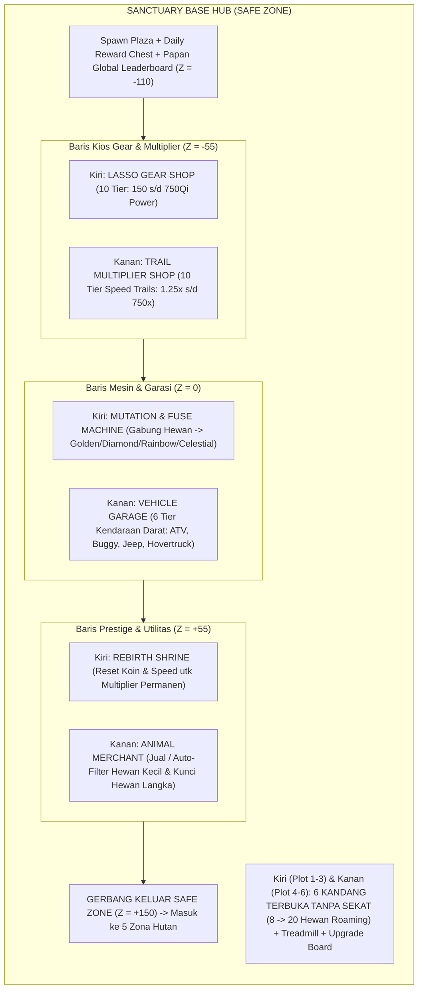

# Wild Rescue: Poacher Run (`StealStealan`) — Game Design & Technical Architecture Plan

> [!IMPORTANT]
> Dokumen ini disusun mengikuti **Development Collaboration Protocol (`docs/instruction.md`)** (**Phase 1: Discovery** & **Phase 2: Planning**) serta prinsip **`agency-roblox-experience-designer`**. Seluruh poin reconcept (Kandang Terbuka Tanpa Sekat 8->20, Ukuran & Mutasi Acak, 63 Animal Index di 5 Zona, 10 Tier Lasso `K–Sp`, 10 Tier Trail Shop, serta Admin Panel & Live Event "Admin Abuse") telah diintegrasikan ke dalam blueprint ini.

---

## Phase 1 — Discovery Summary

1. **Lingkungan & Stack Saat Ini:**
   - **Roblox Studio Live Session:** Terhubung ke `StealSteala` (`placeId: 96456244910807`, `universeId: 10777103449`) dalam mode `Edit`.
   - **Rojo 7.7.1 Live Sync:** Berjalan di `localhost:34872` dengan pemetaan `default.project.json` (`ReplicatedStorage.Shared/Config/Modules`, `ServerScriptService.Services/Systems`, `ServerStorage.Generators`, `StarterPlayerScripts.Client`, `StarterGui.UI`).
   - **Metode Produksi Semi-Automasi AI:** Map bergaya *Blocky Studded*, kendaraan, kandang terbuka, efek partikel/trail, serta script Luau (`--!strict`) dibangun secara modular di repo lokal (Rojo) dan di-generate/diverifikasi langsung di Roblox Studio via MCP (`execute_luau`, `generate_material`, `generate_mesh`, `search_asset`, `insert_asset`, `start_stop_play`).
2. **Analisis Referensi & Celah Keamanan Genre (*Surf and Rescue*, *Steal a Pet and Ride It*, *Steal an Egg*, *Break and Steal Egg*):**
   - Loop utama bertumpu pada: **Kandang Terbuka Pribadi (Open Roaming Pen)** -> **Treadmill + Trail Speed Grinding** -> **Ekspedisi Kendaraan ke 5 Zona Hutan** -> **Tarik Kotak Hewan Nyungsep dengan Lasso** -> **Kabur dari Kejaran Boss Poacher** -> **Unbox Hewan (Ukuran & Mutasi Acak) -> Nyalakan Animal Index -> Hasilkan Uang/detik untuk Upgrade Kandang, Treadmill, Lasso, & Trail**.
   - **Risiko Eksploitasi Spesifik Genre:** Berdasarkan pola auto-farm di game referensi (`AutoSteal`, `Instant Teleport`, `AutoTapBoost` spam, `WalkSpeed/Noclip`), seluruh validasi jarak, durasi tarik lasso, kecepatan gerak saat membawa kotak, klaim reward, serta perintah Admin **wajib 100% Server-Authoritative**.

---

## Phase 2 — Game Design & System Architecture Plan

### 1. Experience Brief & Core Fantasy (`agency-roblox-experience-designer`)
- **Working Title:** **Lasso & Rescue: Escape the Poachers!**
- **Core Fantasy:** Pemain adalah **Ranger Penyelamat Satwa** yang mengendarai kendaraan off-road ke markas pemburu liar di hutan, menggunakan **Lasso** berkekuatan tinggi (`K, M, B, T, Qa, Qi, Sx, Sp`) untuk menarik keluar kotak/kerangkeng hewan yang terperangkap di lumpur/jebakan, lalu **tancap gas kabur dari kejaran Boss Pemburu Liar** untuk melepas hewan tersebut ke dalam **Kandang Terbuka (Open Sanctuary Pen)** milik sendiri agar menghasilkan uang per detik.
- **Target Audiens:** Usia 9–17 tahun (sesi cepat, *high-adrenaline risk vs. reward*, koleksi Index hewan langka berukuran raksasa dan bermutasi).
- **3 Kalimat Viral (Shareable Hooks):**
  1. *"Gue barusan narik kotak Mythic White Tiger di Zona 5 pas dikejar Boss Poacher, pas dibuka dapet ukuran Titanic 3.4x + Mutasi Celestial!"*
  2. *"Lihat kandang gue, udah full upgrade 20 hewan Rainbow & Golden jalan-jalan semua dan ngasilin Triliunan per detik!"*
  3. *"Admin lagi nyalain event Admin Abuse: Hujan Kotak Mythic + 100x Luck Party di server!"*

---

### 2. Core Gameplay Loop, Tata Letak Hub, & Mekanik Utama

```mermaid
flowchart LR
    A["Kandang Terbuka Pribadi (8 -> 20 Hewan Roaming)"] -->|"Hasilkan Uang/detik"| B["Upgrade Kapasitas Kandang, Treadmill, Lasso, & Trail"]
    B -->|"Latihan di Treadmill + Trail Multiplier"| C["Speed Naik Drastis"]
    C -->|"Naik Kendaraan ke 5 Zona"| D["Cari Kotak Hewan Nyungsep (63 Spesies Index)"]
    D -->|"Tarik Pake Lasso (Power vs Resistance)"| E["Kotak Terangkat -> Alarm Poacher Bunyi!"]
    E -->|"Kabur Dikejar Boss Poacher"| F["Bawa Masuk Safe Zone -> Buka di Kandang"]
    F -->|"Roll Ukuran (Min-Max) + Roll Mutasi"| G["Index Menyala + Hewan Jalan-Jalan di Kandang"]
    G --> A
```



#### A. Tata Letak Sanctuary Base Hub (Shops, Machines, & 6 Open-Pen Plots)
Semua fasilitas ditempatkan secara simetris di sepanjang **Boulevard Tengah** agar mudah dijangkau dari ke-6 plot pemain:



#### B. Kandang Terbuka Tanpa Sekat (*Open-Pen Roaming Enclosure* — Kapasitas `8` -> `20`)
- **Kapasitas Server Optimal (6 Pemain / Server):**
  - Server dikunci pada **6 Pemain (`MaxPlayers = 6`)** dengan **6 Plot Permanen (`Plot_1` s/d `Plot_6`)** di kiri dan kanan Boulevard.
- **Desain Kandang Tanpa Sekat (Mirip *Steal an Egg*):**
  - Tidak menggunakan sekat-sekat kecil yang membuat hewan diam. Setiap plot memiliki **1 Kandang Besar Terbuka (`Open Roaming Paddock` berukuran `48 x 44 studs`)** yang dikelilingi pagar rendah.
  - Seluruh hewan milik pemain dijadikan satu di dalam area kandang tersebut dan **bergerak/berkeliaran bebas (wandering, jalan-jalan, & melompat kecil)** memilih titik tujuan acak di dalam pagar kandang!
- **Kapasitas & Progresi Upgrade Kandang:**
  - **Kapasitas Awal:** **`8` hewan** di dalam kandang.
  - **Full Upgrade:** **`20` hewan** maksimal (`8 -> 9 -> 10 ... -> 20` melalui 12 level upgrade menggunakan koin), di mana setiap level upgrade kandang juga memberikan bonus efisiensi `+10% Income`.
- **Fasilitas di Depan Tiap Plot Kandang:**
  1. **Crate Unbox Pad:** Tempat menaruh & membuka kotak hewan hasil tarikan dari hutan.
  2. **Cash Collector Pad:** Injak untuk langsung mengklaim seluruh uang yang dihasilkan hewan di kandang, lengkap dengan papan indikator `Total Income/sec`.
  3. **Pen Capacity Upgrade Stand:** Tombol untuk meng-upgrade kapasitas kandang (`8/20` s/d `20/20`).
  4. **Personal Upgradeable Treadmill / Speed Track:** Tempat latihan kecepatan karakter/kendaraan yang levelnya bisa di-upgrade menggunakan koin (`UpgradeTreadmill`) + memunculkan *Tap Boost Orbs*.

#### C. Sistem Lasso & Ekstraksi Hewan "Nyungsep" (*Dig / Pull Mechanic*)
- Di setiap zona hutan, terdapat **Trapped Animal Crates** yang setengah terkubur di lumpur, semak berduri, pasir, atau es.
- **Mekanik Tarik Lasso:**
  1. Pemain mendekati kotak (`<= LassoMaxRange`) dan menekan prompt/klik **Throw Lasso**.
  2. Tali Lasso (`Beam` bercahaya sesuai tier Lasso) mengikat cincin atas kotak.
  3. **Progress Bar Tarikan:** Kecepatan menarik kotak keluar dari tanah dihitung dari rumus:
     `PullProgressPerSec = (LassoPower * VehicleTorqueMultiplier * TapBoostMultiplier) / CrateResistance`
  4. Saat menarik, muncul indikator **Sweet-Spot / Tap Rhythm** untuk bonus tarikan hingga `+35%`.
  5. **Co-op Dual Lasso:** Jika 2 pemain menarik kotak berat yang sama, `LassoPower` digabung `+25%` bonus pertemanan.

#### D. Sistem Kendaraan Darat, Mount Hewan, & Tombol Slow Mode
- **Kendaraan Darat (6 Tiers):** Digunakan untuk menerabas medan hutan dan menderek (*tow*) kotak hewan di belakang bumper mobil kembali ke Sanctuary (*Safari ATV*, *Ranger Dirt Bike*, *Mud-Crawler Buggy*, *Armored Jeep 4x4*, *Arctic Snowcat*, *Cyber-Ranger Hovertruck*).
- **Rideable Rescued Animals (Mount System):** Hewan favorit di kandang juga bisa ditunggangi (`Ride`) untuk memamerkan ukuran raksasa/mutasinya dan menambah bonus latihan.
- **Built-in "Precision Brake / Slow Mode" Button (`Shift` / Tombol HUD):** Menurunkan kecepatan secara mulus saat mendekati kotak di hutan atau saat menata kandang di Base agar tidak licin/kelewatan ketika Speed sudah sangat tinggi.

#### E. Pengaturan Performa & Audio (Anti-Lag Client Settings & Sound Controls)
Menu **Settings (Gear Icon di HUD)** yang tersimpan di DataStore:
1. **Audio Controls (`SoundService` SoundGroups):**
   - **Toggle & Slider Music (BGM):** Mengatur atau mematikan musik latar (`SoundService.BGMGroup`).
   - **Toggle & Slider SFX:** Mengatur atau mematikan efek suara tarikan lasso, mesin kendaraan, koin, dan sirene Poacher (`SoundService.SFXGroup`).
2. **Performance & Visibility Toggles (Client-Side Culling):**
   - **Hide Other Players' Animals (`hideOtherAnimals`):** Menyembunyikan model 3D, animasi roaming, dan partikel hewan di kandang pemain lain secara lokal di klien.
   - **Hide My Own Animals (`hideOwnAnimals`):** Menyembunyikan visual 3D hewan di kandang sendiri (tetap menghitung uang/detik secara normal) untuk *potato device*.
   - **Reduce VFX / Low Graphics Mode (`lowVFX`):** Mengurangi partikel aura mutasi dan debu kendaraan.

---

### 3. Desain 5 Zona Biome, Multi-Spesies (63 Animal Index), & AI Poacher Boss

Map dirancang memanjang dari **Sanctuary Hub (`Z = 0`)** menuju **5 Zona Hutan** dengan jumlah Index spesies yang semakin banyak di tiap zona (**Total 63 Spesies Hewan**):

| Zona / Biome | Jarak (`Z`) | Jumlah Index Spesies | Musuh & Boss Pemburu Liar | Bonus Jika Index Zona 100% Lengkap |
| :--- | :---: | :---: | :--- | :--- |
| **0. Sanctuary Base Hub** | `-140–150` | Safe Zone | Aman (Poacher tidak bisa masuk) | Tempat 6 Kandang, Shop, & Mesin |
| **1. Whispering Pine Woods** | `150–450` | **10 Spesies (`#01–#10`)** | **Rookie Poacher** & **Boss: Net-Thrower Bob** | Permanen `+15% Speed` & `+10% Cash` |
| **2. Muddy Mangrove Swamp** | `450–800` | **12 Spesies (`#11–#22`)** | **Swamp Tracker** & **Boss: Gator-Truck Gus** | Permanen `+25% Lasso Power` |
| **3. Savanna Poacher Camp** | `800–1200` | **12 Spesies (`#23–#34`)** | **Jeep Poacher** & **Boss: Warden Bulldozer** | Permanen `+35% Cash` & `+1 Kapasitas Kandang` |
| **4. Frostbite Alpine Peaks** | `1200–1650` | **14 Spesies (`#35–#48`)** | **Snowmobile Hunter** & **Boss: Yeti Poacher Mech** | Permanen `+50% Speed` & `+50% Lasso Power` |
| **5. Volcanic Obsidian Jungle** | `1650–2150` | **15 Spesies (`#49–#63`)** | **Elite Drone Hunter** & **Apex Boss: Ironclad Poacher Tank** | Permanen `+100% All Stats` & Title *Apex Ranger* |

#### Daftar Lengkap 63 Spesies Hewan per Zona (Animal Index `#01` s/d `#63`)
1. **Zona 1 — Whispering Pine Woods (10 Index: `#01–#10`):**
   - *Common:* `#01 Rusty Fox`, `#02 Pine Squirrel`, `#03 Hedgehog Scout`, `#04 Badger Digger`
   - *Uncommon:* `#05 Acorn Raccoon`, `#06 Spotted Owl`, `#07 Red Boar`
   - *Rare:* `#08 Antler Stag`, `#09 Timber Lynx`
   - *Epic / Legendary:* `#10 Sylvan Spirit Wolf`
2. **Zona 2 — Muddy Mangrove Swamp (12 Index: `#11–#22`):**
   - *Common:* `#11 Chill Capybara`, `#12 Mud Frog`, `#13 Marsh Duck`, `#14 Swamp Otter`
   - *Uncommon:* `#15 Pink Flamingo`, `#16 Poison Dart Toad`, `#17 Mangrove Crab`
   - *Rare:* `#18 Mossy Snapper`, `#19 Electric Eel`, `#20 Anaconda Striker`
   - *Epic:* `#21 Albino Gator`
   - *Legendary:* `#22 Swamp Hydra Frog`
3. **Zona 3 — Savanna Poacher Camp (12 Index: `#23–#34`):**
   - *Common:* `#23 Dashing Meerkat`, `#24 Savanna Hare`, `#25 Warthog Charger`
   - *Uncommon:* `#26 Blitz Zebra`, `#27 Ostrich Sprinter`, `#28 Spotted Hyena`, `#29 Gazelle Leaper`
   - *Rare:* `#30 Baby Savanna Elephant`, `#31 Armored Rhino`, `#32 Towering Giraffe`
   - *Epic:* `#33 Turbo Cheetah`
   - *Legendary:* `#34 Solar Mane Lion`
4. **Zona 4 — Frostbite Alpine Peaks (14 Index: `#35–#48`):**
   - *Common:* `#35 Emperor Puffin`, `#36 Lemming Jumper`, `#37 Snow Ptarmigan`, `#38 Mountain Goat`
   - *Uncommon:* `#39 Arctic Snow Hare`, `#40 Ice Seal`, `#41 Snowy Owl`, `#42 Bighorn Ram`
   - *Rare:* `#43 Frost Fang Wolf`, `#44 Walrus Tusker`, `#45 Caribou Monarch`
   - *Epic:* `#46 Ghost Snow Leopard`, `#47 Polar Bear Juggernaut`
   - *Legendary:* `#48 Glacier Woolly Mammoth`
5. **Zona 5 — Volcanic Obsidian Jungle (15 Index: `#49–#63`):**
   - *Common:* `#49 Magma Gecko`, `#50 Ash Scorpion`, `#51 Ember Beetle`, `#52 Lava Salamander`
   - *Uncommon:* `#53 Cinder Tusk Boar`, `#54 Obsidian Panther`, `#55 Pyro Toucan`, `#56 Basalt Armadillo`
   - *Rare:* `#57 Komodo Fire Drake`, `#58 Magma Wyvern`, `#59 Hellhound Stalker`
   - *Epic:* `#60 Obsidian Silverback Titan`, `#61 Molten Cerberus`
   - *Legendary:* `#62 Inferno Phoenix`
   - *Mythic:* `#63 Mythic White Tiger`

#### UI Animal Index (Koleksi Menyala & Klaim Reward)
- **Tampilan Grid per Zona:** Menampilkan kartu `#01` s/d `#63` yang dikelompokkan per Zona (dengan tab filter mutasi: *Normal, Albino, Golden, Diamond, Neon, Rainbow, Celestial*).
- **State Belum Didapat:** Kartu tampil berupa **siluet gelap (`???`)** dengan petunjuk lokasi Zona & Rarity.
- **State Sudah Didapat (Index Menyala):** Kartu **menyala penuh warna**, menampilkan badge **Rekor Ukuran Terbesar (`Max Size Ratio / kg`)** yang pernah dibuka pemain, serta tombol **`Claim Index Reward`** (atau `Claim All Index Rewards`).

---

### 4. Variasi Ukuran Acak (`Min–Max Size Ratio`), Mutasi Langka, & Rumus Income/sec

#### A. Sistem Ukuran Acak (`sizeRatio` — Min, Max, & Rasio Gedenya)
Saat kotak hewan dibuka di kandang, server melakukan roll ukuran acak dari `0.70x` hingga `3.50x` (dan skala model 3D hewan di dalam kandang benar-benar membesar sesuai angka ini!):

| Kategori Ukuran | Rentang `sizeRatio` | Peluang Roll | Multiplier Income (`sizeRatio^1.5`) |
| :--- | :---: | :---: | :---: |
| **Tiny** | `0.70x – 0.89x` | `20.0%` | `0.58x – 0.84x` |
| **Normal** | `0.90x – 1.25x` | `55.0%` | `0.85x – 1.40x` |
| **Big / Chubby** | `1.26x – 1.75x` | `18.0%` | `1.41x – 2.31x` |
| **Giant** | `1.76x – 2.40x` | `5.5%` | `2.33x – 3.72x` |
| **Titanic / Behemoth** | `2.41x – 3.50x` | `1.5%` | `3.74x – 6.55x` |

#### B. Sistem Mutasi Hewan (`mutation` — 7 Tingkatan Kelangkaan)
Setiap hewan yang dibuka (atau dimasukkan ke *Mutation & Fuse Machine*) memiliki peluang memperoleh mutasi langka:

| Mutasi | Peluang Roll | Multiplier Income | Efek Visual pada Hewan di Kandang |
| :--- | :---: | :---: | :--- |
| **Normal (`None`)** | `72.0%` | `1.0x` | Warna asli spesies |
| **Albino** | `12.0%` | `1.8x` | Warna putih bersih kontras + mata menyala |
| **Golden** | `8.0%` | `3.5x` | Material `Foil/Metal` emas berkilau + partikel koin |
| **Diamond / Crystal** | `4.5%` | `7.5x` | Material `Glass/Ice` biru kristal transparan |
| **Neon / Electric** | `2.2%` | `16.0x` | Material `Neon` menyala terang + kilatan listrik |
| **Rainbow** | `1.0%` | `35.0x` | Siklus warna pelangi dinamis (*Hue-Cycling*) |
| **Celestial / Void** | `0.3%` | `85.0x` | Tekstur kosmik ungu-emas + aura bintang mengorbit |

#### C. Rumus Penghasilan Uang per Detik (`Income / sec`)
Setiap hewan yang bergerak di dalam kandang menghasilkan uang per detik berdasarkan **Rarity Spesies + Ukuran (`sizeRatio`) + Mutasi**:
```text
AnimalIncomePerSec = SpeciesBaseIncome * (sizeRatio ^ 1.5) * MutationMultiplier
TotalPlotIncomePerSec = Sum(AnimalIncomePerSec) * PenUpgradeMultiplier * RebirthMultiplier * VIPMultiplier * ServerEventMultiplier
```
Uang yang dihasilkan digunakan untuk:
1. **Upgrade Kapasitas Kandang** (`8` awal -> `20` maksimal + bonus efisiensi kandang),
2. **Upgrade Treadmill Level** (mempercepat perolehan *Speed/sec*),
3. **Membeli 10 Tier Lasso**, dan
4. **Membeli 10 Tier Speed Trail** serta **Kendaraan Ekspedisi**.

---

### 5. Progresi Gear: 10 Tier Lasso (`K, M, B, T, Qa, Qi, Sx, Sp`) & 10 Tier Trail

Format angka di `FormatUtil.luau` mendukung singkatan penuh: **`K`, `M`, `B`, `T`, `Qa`, `Qi`, `Sx`, `Sp`, `Oc`, `No`, `Dc`**.

#### A. 10 Tingkatan Lasso (Untuk Menarik Kotak Hewan)
| Tier | ID Lasso | Nama Lasso | Kekuatan Tarik (`Pull Power`) | Harga Beli (`Coins`) | Warna Beam Lasso |
| :---: | :--- | :--- | :---: | :---: | :--- |
| **1** | `RopeLasso` | **Starter Hemp Lasso** | `150` | **Gratis** | Cokelat Tambang |
| **2** | `IronRopeLasso` | **Reinforced Iron Rope** | `3.5K` (`3.5e3`) | `2.5K` | Abu-abu Baja |
| **3** | `TaserTether` | **High-Volt Taser Tether** | `120K` (`1.2e5`) | `85K` | Kuning Listrik |
| **4** | `HydraulicWinch` | **Hydraulic Winch Cable** | `5.5M` (`5.5e6`) | `3.8M` | Oranye Hidrolik |
| **5** | `TitaniumGrapple` | **Titanium Mag-Grapple** | `320M` (`3.2e8`) | `220M` | Biru Kobalt |
| **6** | `PlasmaLasso` | **Plasma Core Lasso** | `18B` (`1.8e10`) | `12B` | Ungu Plasma |
| **7** | `DarkMatterWhip` | **Dark-Matter Whip** | `1.2T` (`1.2e12`) | `850B` | Merah Kirmizi Neon |
| **8** | `QuantumTether` | **Quantum Singularity Tether** | `95T` (`9.5e13`) | `65T` | Cyan Kuantum |
| **9** | `CelestialChain` | **Celestial Star-Chain** | `8.5Qa` (`8.5e15`) | `5.5Qa` | Emas Bintang |
| **10** | `OmniverseLasso` | **Omniverse Apex Lasso** | `750Qi` (`7.5e17`) *(Upgradeable s/d `Sx` & `Sp`)* | `480Qi` | Pelangi Kosmik |

#### B. 10 Tingkatan Trail di Trail Shop (Multiplier Speed & Cash)
Menggunakan instance `Trail` ringan pada karakter (tanpa membebani mesh karakter):
| Tier | ID Trail | Nama Trail | Speed Multiplier | Bonus Cash | Harga Beli (`Coins`) |
| :---: | :--- | :--- | :---: | :---: | :---: |
| **1** | `BreezeTrail` | **Wind Breeze Trail** | `1.25x` | `+0%` | **Gratis** |
| **2** | `LeafTrail` | **Forest Leaf Trail** | `1.75x` | `+5%` | `1.2K` |
| **3** | `SparkTrail` | **Amber Spark Trail** | `2.80x` | `+10%` | `45K` |
| **4** | `HydroTrail` | **Hydro Wave Trail** | `5.00x` | `+15%` | `1.5M` |
| **5** | `VoltTrail` | **Volt Lightning Trail** | `10.0x` | `+20%` | `80M` |
| **6** | `PlasmaTrail` | **Plasma Ribbon Trail** | `22.0x` | `+30%` | `4.2B` |
| **7** | `CrimsonTrail` | **Crimson Flame Trail** | `50.0x` | `+40%` | `260B` |
| **8** | `FrostTrail` | **Frost Nova Trail** | `120x` | `+55%` | `18T` |
| **9** | `StarlightTrail` | **Celestial Starlight Trail** | `300x` | `+75%` | `1.4Qa` |
| **10** | `RainbowTrail` | **Omniverse Rainbow Trail** | `750x` | `+100%` | `110Qi` |

---

### 6. Sistem Admin Panel & "Admin Abuse" Live Event System

Untuk memudahkan kontrol penuh atas game, moderasi pemain, penyesuaian ekonomi langsung (*live tuning*), serta mengadakan event seru ala **"Admin Abuse"** yang disukai komunitas Roblox, tersedia **Admin Control Panel (`F2` / Tombol `[ADMIN]` di HUD)**.

#### A. Sistem Hak Akses Berlapis (Server-Verified RBAC)
Seluruh request Admin divalidasi 100% di sisi server melalui `AdminService.luau` + `AdminConfig.luau` (`game.CreatorId`, Studio Tester, dan daftar `UserId` Admin/Moderator di DataStore):
- **Rank 3 — Owner / SuperAdmin:** Akses penuh ke seluruh fitur, kelola daftar Admin/Moderator, Wipe/Edit Data, dan Global Events.
- **Rank 2 — Admin / Event Host:** Menjalankan event *Admin Abuse*, Spawn Hewan/Kotak kustom, Give Coins/Speed, dan Global Broadcast.
- **Rank 1 — Moderator:** Kick, Temp/Perm Ban pemain (`BanStore_v1`), Freeze/Bring/Teleport ke pemain, dan cek log anti-cheat.

#### B. 5 Tab Fitur Utama di Admin Panel UI
1. **Tab 1: Moderation & Player Control (`Ban / Kick / Inspect`):**
   - Pilih pemain di server atau ketik `UserId` -> **`Kick`**, **`Temp Ban (1h / 24h / 7d)`**, **`Permanent Ban`** (tersimpan di DataStore `BanStore_v1` + alasan ban), **`Unban`**.
   - Tombol cepat: **`Teleport To`**, **`Bring to Me`**, **`Freeze / Unfreeze`**, dan **`Inspect Kandang & Inventory`**.
2. **Tab 2: Economy & Live Value Tuner (`Give Stats / Edit Values`):**
   - **Give / Set Stat Pemain:** Tambah atau atur `Coins` (mendukung input singkat seperti `50M`, `10B`, `5Qa`), `Speed Stat`, `Rebirths`, `Pen Capacity (8–20)`, `Treadmill Level`, atau tombol **`Unlock All Gear & Full Index`**.
   - **Live Value Multiplier:** Ubah multiplier `Global Cash Rate`, `Global Speed Rate`, `Poacher WalkSpeed`, atau `Crate Resistance` secara langsung tanpa restart server!
3. **Tab 3: Custom Animal & Crate Spawner (`Direct Spawn`):**
   - **Spawn Hewan ke Kandang:** Pilih `Spesies (#01–#63)` + Pilih `Mutasi (Normal / Albino / Golden / Diamond / Neon / Rainbow / Celestial)` + Atur `SizeRatio (0.7x s/d 10.0x Raksasa!)` -> langsung masuk dan jalan-jalan di kandang pemain yang dipilih!
   - **Spawn Kotak di Map:** Munculkan kotak *Mythic / Celestial* tepat di depan Admin atau di zona tertentu.
4. **Tab 4: "Admin Abuse" & Server-Wide Live Events (One-Click Chaos & Party!):**
   - Memicu event seluruh server lengkap dengan **Banner Pengumuman Layar Penuh + Efek Langit/Suara**:
     - **Crate Rain (Hujan Kotak Langka):** Menjatuhkan 25 kotak *Epic/Legendary/Mythic* dari langit di seluruh map!
     - **100x Rainbow & Celestial Mutation Party:** Meningkatkan peluang mutasi langka & ukuran *Titanic* secara drastis selama durasi event!
     - **Golden Fever (25x / 100x Cash & Speed):** Mengalikan pendapatan uang kandang dan perolehan speed treadmill seluruh pemain!
     - **Titanic Zoo Mode (Giant Animals):** Membuat semua hewan yang sedang jalan-jalan di kandang berubah ukuran menjadi raksasa sementara!
     - **Zero Resistance Mode (Instant Lasso Pull):** Semua pemain bisa mencabut kotak seberat apa pun dalam 1 detik!
     - **Hyper Poacher Stampede:** Boss Poacher berubah ukuran jadi raksasa dan berlari 3x lebih cepat (mode tantangan berhadiah koin besar!).
     - **Global Server Broadcast:** Kirim teks pengumuman kustom ke layar seluruh pemain.
5. **Tab 5: Admin Self-Tools (`Quick Toggles`):**
   - `God Mode (Poacher Ignore Admin)`, `Instant Lasso Pull`, `Instant Unbox`, `Super Speed`, dan `Respawn All Crates`.

---

### 7. Ethical Monetization & Retention Design (`agency-roblox-experience-designer`)

#### A. Game Passes (Permanent Benefits — `MarketplaceService:UserOwnsGamePassAsync`)
| Game Pass | Harga (Robux) | Manfaat Permanen |
| :--- | :---: | :--- |
| **VIP Ranger Pass** | `299 R$` | `+50%` Cash Income, VIP Golden Name Tag, `1.5x` Treadmill Speed, & Golden Safari Jeep |
| **2x Speed Training** | `199 R$` | Menggandakan perolehan *Speed* saat latihan di Treadmill |
| **2x Lasso Pull Power** | `249 R$` | Menggandakan kekuatan tarik Lasso (ekstraksi kotak 2x lebih cepat) |
| **Dual Tow Hook (Carry +1 Crate)** | `349 R$` | Bisa menarik dan menderek **2 kotak hewan sekaligus** dalam satu perjalanan |
| **Auto-Unbox & Auto-Collect** | `149 R$` | Otomatis mengumpulkan uang kandang & otomatis membuka kotak yang ditaruh di kandang |
| **Extra Pen Capacity (+5 Max Animals)** | `199 R$` | Menambah batas maksimum hewan di kandang terbuka (`20 -> 25` hewan aktif) & `+50` slot tas |

#### B. Developer Products (Consumables — `MarketplaceService.ProcessReceipt`)
- **Starter Ranger Pack:** `99 R$` — *High-Volt Taser Tether (Tier 3) + Mud-Crawler Buggy + Amber Spark Trail + 100K Coins*.
- **Server-Wide 10x Mutation Luck Party (15 Menit):** `75 R$`.
- **Instant Unbox / Instant Fuse:** `25 R$` – `49 R$`.
- **Coin Bundles:** Tier harga standar (`49 R$`, `149 R$`, `399 R$`, `999 R$`) yang diskalakan dengan progresi pemain.

---

### 8. Security & Anti-Exploit Architecture

1. **Anti-Teleport & Towing Velocity Envelope:**
   - Server mencatat posisi dan waktu saat pemain berhasil mengangkat kotak (`CrateHookedTimestamp`, `OriginPosition`). Jika pemain sampai di Sanctuary Plot lebih cepat dari batas fisik maksimum, server menolak penempatan kotak.
2. **Server-Authoritative Lasso Pull & Admin Validation:**
   - Klien hanya mengirim `RequestStartPull(crateId)` -> Server memvalidasi jarak dan menghitung progres tarikan sesuai `LassoPower` milik pemain.
   - Seluruh remote `AdminCommand` memverifikasi `AdminService.GetAdminRank(player.UserId) >= requiredRank` di sisi server; pemain biasa yang mencoba memanggil remote Admin langsung ditolak dan dicatat di log moderasi.
3. **Server-Side Poacher Hit Detection:**
   - Tabrakan antara Poacher/Boss dan pemain dihitung berdasarkan jarak horizontal (`XZ-plane`) di server (kecuali Admin yang menyalakan toggle *God Mode*).

---

### 9. DataStore Schema & Progression Safety (`PlayerData_v2` & `BanStore_v1`)

```luau
export type AnimalMutation = "None" | "Albino" | "Golden" | "Diamond" | "Neon" | "Rainbow" | "Celestial"

export type AnimalInstance = {
	uid: string,               -- GUID unik
	speciesId: string,         -- Contoh: "RustyFox", "MythicWhiteTiger" (#01 s/d #63)
	sizeRatio: number,         -- 0.70 s/d 3.50+ (menentukan skala 3D & multiplier uang)
	weightKg: number,          -- Berat proporsional untuk ditampilkan di UI & Index
	mutation: AnimalMutation,  -- "None" | "Albino" | "Golden" | "Diamond" | "Neon" | "Rainbow" | "Celestial"
	locked: boolean,           -- Mencegah terjual/ter-fuse tidak sengaja
	acquiredAt: number,
}

export type PlayerProfileSchema = {
	schemaVersion: number,
	coins: number,
	gems: number,
	speedStat: number,
	rebirths: number,

	-- Kandang & Treadmill Upgrades
	penCapacity: number,       -- Mulai dari 8, upgradeable s/d 20 (atau 25 dgn Pass)
	penUpgradeLevel: number,   -- Level 1 s/d 13
	treadmillLevel: number,    -- Level 1+ untuk multiplier latihan speed
	unclaimedPenCoins: number, -- Uang yang terakumulasi di Cash Collector Pad kandang

	-- Gear & Trails
	equippedLasso: string,
	ownedLassos: { [string]: boolean },
	equippedTrail: string,
	ownedTrails: { [string]: boolean },
	equippedVehicle: string,
	ownedVehicles: { [string]: boolean },

	-- Hewan di Kandang Terbuka & Tas
	roamingAnimalUids: { string },                -- Daftar UID hewan yang sedang jalan-jalan di kandang (maks penCapacity)
	inventoryAnimals: { [string]: AnimalInstance },
	pendingCrates: { [string]: CrateInstance },

	-- Animal Index (63 Spesies)
	discoveredIndex: { [string]: {
		count: number,
		maxSizeRatio: number,
		mutationsFound: { [string]: boolean },
		rewardClaimed: boolean,
	} },

	dailyReward: {
		lastClaimTime: number,
		streak: number,
	},
	settings: {
		musicEnabled: boolean,
		musicVolume: number,
		sfxEnabled: boolean,
		sfxVolume: number,
		hideOtherAnimals: boolean,
		hideOwnAnimals: boolean,
		lowVFX: boolean,
	},
	analyticsMeta: {
		firstJoinTime: number,
		totalPlaytimeSeconds: number,
		onboardingStep: number,
	},
}
```

---

### 10. Struktur Direktori Proyek (Rojo + Studio Automation)

```text
StealStealan/
├── default.project.json
├── docs/
│   ├── instruction.md
│   └── GAME_DESIGN_AND_ARCHITECTURE.md
├── .agents/
│   └── skills/
│       └── agency-roblox-experience-designer/
├── generators/
│   ├── BlockyMapBiomeGenerator.luau   # Generator 5 Zona Blocky Studded + Creator Store Decor
│   └── SanctuarySixPlotGenerator.luau # Generator Hub + Shop/Mesin + 6 Kandang Terbuka Tanpa Sekat (8->20)
└── src/
    ├── ReplicatedStorage/
    │   ├── Config/
    │   │   ├── GameConfig.luau        # Konstanta global, ukuran (sizeRatio), mutasi, & rumus ekonomi
    │   │   ├── LassoConfig.luau       # 10 Tier Lasso (150 s/d 750Qi Power)
    │   │   ├── TrailConfig.luau       # 10 Tier Trail Multiplier (1.25x s/d 750x Speed)
    │   │   ├── VehicleConfig.luau     # 6 Tier Kendaraan Darat
    │   │   ├── AnimalConfig.luau      # 63 Spesies Hewan (Zona 1: 10, Zona 2: 12, Zona 3: 12, Zona 4: 14, Zona 5: 15)
    │   │   ├── BiomeConfig.luau       # Data 5 Zona Biome, Crate Resistance, & Boss Poacher
    │   │   ├── AdminConfig.luau       # Daftar UserId Owner/Admin/Moderator & daftar preset Admin Abuse Event
    │   │   ├── SoundConfig.luau       # Konfigurasi SoundGroup BGM & SFX
    │   │   └── MonetizationConfig.luau# ID Game Pass & Developer Products
    │   ├── Shared/
    │   │   ├── Types.luau             # Definisi tipe Luau (--!strict)
    │   │   └── Remotes.luau           # Kontrak RemoteEvents (Gameplay + Index + Trail + Admin Panel)
    │   └── Modules/
    │       ├── FormatUtil.luau        # Formatter angka (K, M, B, T, Qa, Qi, Sx, Sp, Oc, No, Dc)
    │       └── AnimalVisualBuilder.luau# Builder model 3D hewan blocky + skala sizeRatio + material/aura mutasi
    ├── ServerScriptService/
    │   ├── Services/
    │   │   ├── DataService.luau       # DataStore PlayerData_v2 & BanStore_v1 + Session Lock
    │   │   ├── PlotService.luau       # 6 Open-Pen Plots, Roaming Animals, Income/sec, & Upgrade Kandang (8->20)
    │   │   ├── EconomyService.luau    # Shop 10 Lasso, 10 Trail, 6 Kendaraan, Treadmill Upgrade, Index Claim, & Rebirth
    │   │   ├── AdminService.luau      # Server RBAC, Ban/Kick, Live Value Tuner, Spawner, & "Admin Abuse" Live Events
    │   │   ├── PassManager.luau       # Game Pass, Developer Products, & Daily Rewards
    │   │   └── AnalyticsTracker.luau  # AnalyticsService Funnel
    │   └── Systems/
    │       ├── LassoRescueSystem.luau # Crate Spawner, Lasso Pull (K-Sp Power), & Towing Anti-Cheat
    │       ├── PoacherAISystem.luau   # Patroli & Aggro Chase Poacher/Boss per Zona
    │       ├── TrainingSystem.luau    # Treadmill Speed Training + Trail Multiplier + Tap Boost
    │       └── FuseMergeSystem.luau   # Mesin Fuse & Evolusi Mutasi Hewan
    ├── StarterPlayer/
    │   └── StarterPlayerScripts/
    │       ├── RescueClient.client.luau          # Visual Beam Lasso, UI Tarik Kotak, & Tombol Slow Mode
    │       ├── RoamingPenClient.client.luau      # Animasi Hewan Jalan-Jalan Bebas di Kandang Terbuka + Size & Mutasi VFX
    │       ├── VehicleAndTrailClient.client.luau # Kontrol Kendaraan, Ride Animal, & Efek Trail Karakter
    │       └── SettingsAndAudioClient.client.luau# Kontrol BGM/SFX & Toggle Hide Other/Own Animals
    └── StarterGui/
        └── UI/
            ├── MainHUD.client.luau    # HUD Utama, Index UI (63 Hewan Menyala), Shop Lasso/Trail, Fuse, & Settings
            └── AdminPanel.client.luau # UI Admin Panel 5-Tab (Moderation, Economy, Spawner, Admin Abuse Events, Tools)
```
