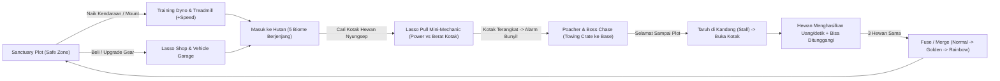
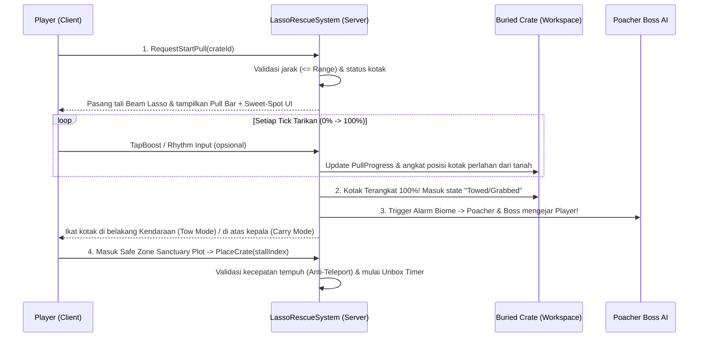

# Wild Rescue: Poacher Run (`StealStealan`) — Game Design & Technical Architecture Plan

> [!IMPORTANT]
> Dokumen ini disusun mengikuti **Development Collaboration Protocol (`instruction.md`)** (**Phase 1: Discovery** & **Phase 2: Planning**) serta prinsip **`agency-roblox-experience-designer`**. Rencana ini menjadi acuan utama sebelum dan selama **Phase 3 (Implementation)**.

---

## Phase 1 — Discovery Summary

1. **Lingkungan & Stack Saat Ini:**
   - **Roblox Studio Live Session:** Terhubung ke `StealSteala` (`placeId: 96456244910807`, `universeId: 10777103449`) dalam mode `Edit`.
   - **Rojo 7.7.1 Live Sync:** Berjalan di `localhost:34872` dengan pemetaan `default.project.json` (`ReplicatedStorage.Shared/Config/Modules`, `ServerScriptService.Services/Systems`, `StarterPlayerScripts.Client`, `StarterGui.UI`).
   - **Metode Produksi Semi-Automasi AI:** Map, kendaraan prosedural, kandang, efek partikel, serta script Luau (`--!strict`) dibangun secara modular di repo lokal (Rojo) dan di-generate/diverifikasi langsung di Roblox Studio via MCP (`execute_luau`, `screen_capture`, `start_stop_play`).
2. **Analisis Referensi & Celah Keamanan Genre (*Surf and Rescue*, *Steal a Pet and Ride It*, *Break and Steal Egg*):**
   - Dari struktur mekanik genre ini, loop utamanya bertumpu pada: **Base Plot Pribadi (Zoo/Sanctuary)** -> **Speed/Vehicle Training** -> **Ekspedisi ke Zona Bahaya (Biomes)** -> **Ekstraksi Objek (Lasso Pull/Dig)** -> **Kabur dari Kejaran Boss (Poacher Chase)** -> **Unbox, Fuse/Merge, & Passive Income**.
   - **Risiko Eksploitasi Spesifik Genre:** Berdasarkan pola auto-farm di game referensi (`AutoSteal`, `Instant Teleport`, `AutoTapBoost` spam, `WalkSpeed/Noclip`), seluruh validasi jarak, durasi tarik lasso, kecepatan gerak saat membawa kotak, dan klaim reward **wajib 100% Server-Authoritative**.

---

## Phase 2 — Game Design & System Architecture Plan

### 1. Experience Brief & Core Fantasy (`agency-roblox-experience-designer`)
- **Working Title:** **Lasso & Rescue: Escape the Poachers!**
- **Core Fantasy:** Pemain adalah **Ranger Penyelamat Satwa** yang mengendarai kendaraan off-road ke markas pemburu liar di hutan, menggunakan **Lasso** untuk menarik keluar kotak/kerangkeng hewan yang terperangkap di lumpur/jebakan, lalu **tancap gas kabur dari kejaran Boss Pemburu Liar** untuk merawat hewan tersebut di **Sanctuary Zoo** milik sendiri.
- **Target Audiens:** Usia 9–17 tahun (sesi cepat, *high-adrenaline risk vs. reward*, koleksi hewan langka yang bisa ditunggangi/dipamerkan ke teman).
- **3 Kalimat Viral (Shareable Hooks):**
  1. *"Gue barusan narik kotak Mythic White Tiger di biome terdalam pas dikejar Boss Poacher 1 inci di belakang mobil!"*
  2. *"Lihat Zoo gue, gue udah nge-Fuse 3 Golden Panda jadi Rainbow Mount yang bisa dinaikin bareng!"*
  3. *"Bantu gue narik kerangkeng Boss Crate berdua pake Co-op Lasso biar dapet 2x kecepatan tarik!"*

---

### 2. Core Gameplay Loop & Mekanik Utama



#### A. Sistem Lasso & Ekstraksi Hewan "Nyungsep" (*Dig / Pull Mechanic*)
- Di setiap biome hutan, terdapat **Trapped Animal Crates** (kotak/kandang hewan yang setengah terkubur di lumpur, semak berduri, akar pohon, atau es).
- **Mekanik Tarik Lasso:**
  1. Pemain mendekati kotak (`<= 16 studs`) dan menekan prompt/klik **Throw Lasso**.
  2. Tali Lasso (`Beam` / `RopeConstraint` dengan efek tegang) mengikat kotak.
  3. **Progress Bar Tarikan:** Kecepatan menarik kotak keluar dari tanah dihitung dari rumus:
     `PullProgressPerSec = (LassoPower * VehicleTorqueMultiplier * TapBoostMultiplier) / CrateResistance`
  4. Saat menarik, muncul indikator **Sweet-Spot / Tap Rhythm** untuk bonus tarikan hingga `+35%`.
  5. **Co-op Dual Lasso (Social Hook):** Jika 2 pemain menarik kotak berat yang sama, `LassoPower` digabung `+25%` bonus pertemanan, dan keduanya mendapat drop kotak!

#### B. Sistem Kendaraan Darat & Mount Hewan (*Surf & Rescue* + *Steal a Pet and Ride It*)
- **Kendaraan Darat (Expedition Vehicles):** Digunakan untuk menerabas medan hutan dan menderek (*tow*) kotak hewan kembali ke Sanctuary:
  - *Tier 1:* Safari ATV Quadbike (Starter — Gratis)
  - *Tier 2:* Mud-Crawler Buggy (Tidak melambat di lumpur)
  - *Tier 3:* Armored Rescue Jeep 4x4 (Tahan 1x tabrakan Poacher)
  - *Tier 4:* Cyber-Ranger Hovertruck (Kecepatan tinggi + 2x Crate Towing Slot)
- **Rideable Rescued Animals (Mount System):** Hewan yang sudah diselamatkan dan ditaruh di Zoo tidak hanya menghasilkan koin/detik, tetapi juga bisa **ditunggangi (`Ride`)** untuk memamerkan aura/rarity dan dipakai di area **Training Track** untuk menggandakan perolehan *Speed EXP*.
- **Built-in "Precision Brake / Slow Mode" Button (QoL Resmi di UI):**
  - Belajar dari masalah kontrol di *Steal a Pet and Ride It* saat speed pemain sudah ribuan/jutaan (karakter licin dan kelewatan kotak), kita sediakan tombol resmi **Brake / Slow Mode (`Shift` / Tombol Layar)** yang menurunkan kecepatan secara mulus saat mendekati kotak atau menata kandang di Base.

#### C. Training, Speed, & Rebirth Loop
- **Training Zone di Plot Pribadi:**
  - Memiliki **Dyno Ramp / Speed Track** tempat pemain melatih *Speed Stat* menggunakan kendaraan atau hewan tunggangan.
  - Saat latihan, muncul **Boost Orbs** berkala yang bisa diklik untuk bonus Speed/Koin.
  - **Upgrade Training Station:** Meningkatkan multiplier Speed per detik menggunakan koin.
- **Rebirth System:**
  - Ketika mencapai syarat *Speed* dan *Koin*, pemain bisa **Rebirth** (mereset Speed & Koin, namun **menyimpan** Hewan Langka/Fuse, Game Pass, dan mendapatkan **Permanent Cash/Lasso Multiplier** + akses ke zona VIP/Rebirth).

#### D. Sanctuary Zoo Plot, Unbox, Fuse & Merge (6 Pre-Allocated Plots)
- **Kapasitas Server Optimal (6 Pemain / Server):**
  - Server dikunci pada **6 Pemain (`MaxPlayers = 6`)** untuk menjaga **60 FPS stabil di Mobile & PC** meskipun setiap pemain memiliki puluhan hewan berpartikel dan kendaraan aktif.
  - **6 Kandang Utama (Sanctuary Plots `Plot_1` s/d `Plot_6`) sudah tersedia secara permanen di Map** (3 di sisi kiri boulevard utama, 3 di sisi kanan) lengkap dengan papan nama pemilik, Dyno Track pribadi, dan slot kandang.
  - Saat pemain masuk, `PlotService` langsung mengklaim 1 plot kosong tanpa perlu *spawn* geometri berat secara *runtime*.
- **Fitur di Dalam Tiap Plot:**
  - **Enclosure Stalls (Kandang Zoo):** Mulai dari 4 kandang aktif, bisa di-upgrade hingga 20 kandang (`UpgradePlot`).
  - **Crate Unbox Timer:** Kotak yang berhasil dibawa pulang ditaruh di slot kandang, memiliki waktu buka singkat (5–60 detik sesuai rarity) sebelum hewan keluar.
  - **Fuse & Merge Machine:**
    - **Merge (3-in-1 Tier Evolution):** Gabungkan 3 hewan identik -> naik tier (**Normal** -> **Golden (2.5x Income)** -> **Rainbow (6x Income)** -> **Galactic (15x Income)**).
    - **Fuse Machine (Cross-Combination):** Masukkan 3–5 hewan bebas untuk peluang mendapatkan hewan *Mutated / Secret Rarity*.
  - **Animal Codex (Index Rewards):** Koleksi buku indeks hewan per biome; setiap menyelesaikan 1 set biome memberikan bonus permanen Speed/Lasso Power.

#### E. Pengaturan Performa & Audio (Anti-Lag Client Settings & Sound Controls)
Untuk mencegah *frame drop* saat semua kandang penuh dengan hewan berefek Golden/Rainbow, tersedia menu **Settings (Gear Icon di HUD)** yang tersimpan di DataStore:
1. **Audio Controls (`SoundService` SoundGroups):**
   - **Toggle & Slider Music (BGM):** Mengatur atau mematikan musik latar per biome (`SoundService.BGMGroup`).
   - **Toggle & Slider SFX:** Mengatur atau mematikan efek suara tarikan lasso, mesin kendaraan, koin, dan sirene Poacher (`SoundService.SFXGroup`).
2. **Performance & Visibility Toggles (Client-Side Culling):**
   - **Hide Other Players' Animals (`hideOtherAnimals`):** Menyembunyikan model 3D, animasi *idle*, *BillboardGui* penghasil uang, dan partikel aura hewan milik pemain lain di plot tetangga (hanya dijalankan di sisi klien lokal sehingga tidak memengaruhi pemain lain).
   - **Hide My Own Animals (`hideOwnAnimals`):** Menyembunyikan visual 3D hewan di kandang sendiri (tetap menampilkan teks jumlah *income/sec* secara minimalis di papan slot) untuk *potato device* saat fokus *grinding* kecepatan/ekspedisi.
   - **Reduce VFX / Low Graphics Mode (`lowVFX`):** Mematikan partikel debu kendaraan dan efek konfeti berlebih.

---

### 3. Biomes, Tema Map, & AI Poacher / Boss Chase

Map dirancang memanjang secara progresif dari **Sanctuary Hub (Z = 0)** menuju **5 Biome Hutan** yang semakin jauh dan berbahaya:

| Zona / Biome | Jarak dari Base | Medan & Hambatan | Musuh & Boss Pemburu Liar | Hewan yang Diselamatkan |
| :--- | :---: | :--- | :--- | :--- |
| **0. Sanctuary Base Hub** | `0–150 studs` | Aman (Safe Zone), Plot Zoo, Shop, Fuse Machine, Dyno Track | Tidak ada (Poacher tidak bisa masuk) | Tempat pamer & kandang |
| **1. Whispering Pine Woods** | `150–450 studs` | Jalan tanah, semak ringan | **Rookie Poacher** (Patroli lambat) & **Boss: Net-Thrower Bob** | Rubah, Rusa, Rakun, Beruang Madu |
| **2. Muddy Mangrove Swamp** | `450–800 studs` | Lumpur penghambat speed (`-40%` tanpa Buggy), jembatan kayu | **Swamp Tracker** & **Boss: Gator-Truck Gus** | Kapibara, Buaya Putih, Flamingo, Kura-kura Emas |
| **3. Savanna Poacher Camp** | `800–1200 studs` | Padang rumput terbuka, barikade kawat berduri, menara pantau | **Jeep Poacher** & **Boss: Warden Bulldozer** | Singa, Zebra Langka, Gajah Kecil, Cheetah |
| **4. Frostbite Alpine Peaks** | `1200–1650 studs` | Es licin, batu longsor, jurang sempit | **Snowmobile Hunter** & **Boss: Yeti Poacher Mech** | Macan Tutul Salju, Serigala Kutub, Penguin Kaisar, Mammoth |
| **5. Volcanic Obsidian Jungle** | `1650–2200 studs` | Sungai lava, geyser api, jebakan laser pemburu | **Elite Drone Hunter** & **Apex Boss: Ironclad Poacher Tank** | Harimau Putih Mythic, Komodo Naga, Gorilla Emas, Phoenix |

- **Mekanik Kejaran (Chase State):**
  - Saat berjalan biasa tanpa membawa kotak, Poacher hanya berpatroli dengan radius deteksi pendek.
  - **Begitu pemain selesai menarik kotak dengan Lasso**, sirene kamp pemburu berbunyi! Boss Biome dan Poacher terdekat masuk ke mode **Aggro Pursuit** mengejar pemain sampai ke garis batas Safe Zone.
  - Jika tertangkap Poacher: pemain **tidak mati permanen**, melainkan terpental ke pos pemeriksaan terakhir dan kotak hewan terlepas kembali (tetap ramah anak usia 9–17 tahun tanpa rasa frustrasi berlebihan).

#### Gaya Visual Map & Pipeline Aset (*Blocky Studded Style* seperti *Steal an Egg* + Creator Store Assets)
- **Dilarang Menggunakan Default Smooth Terrain Polos:**
  - Map **tidak** menggunakan *Smooth Voxel Terrain* bawaan Roblox yang berat dan generik, melainkan **Stylized Blocky / Layered Studded Terrain** (susunan balok bertingkat dengan permukaan *Studs* klasik, garis batas zona warna-warni yang kontras, tebing berundak kotak-kotak, dan *hazard tiles* ala *Steal an Egg* & *Steal a Pet and Ride It*).
- **Kombinasi Pipeline Aset (Marketplace + AI Generator + Custom MaterialVariant):**
  1. **Creator Store / Marketplace Asset Discovery (`search_asset` & `insert_asset`):** Mencari dan mengkurasi model hewan low-poly/blocky, kendaraan off-road, pagar kandang, peti kayu (*crates*), dan properti per biome langsung dari katalog aset Roblox Studio.
  2. **AI 3D Mesh & Custom Material (`generate_mesh`, `generate_material`, `generate_procedural_model`):** Membuat variasi material permukaan kotak-kotak (*studded grass, blocky mud, icy studs, volcanic basalt blocks*) serta properti unik (mesin Fuse, gerbang Biome, perangkap Poacher).
  3. **Optimasi Collision & Anchoring:** Seluruh blok dekorasi tebing dan pohon disetel `Anchored = true`, `CanQuery = false`, dan `CanTouch = false` (kecuali zona interaktif) agar fisika kendaraan dan *raycast* Lasso super ringan.

---

### 4. Desain Target Objek (Kotak & Hewan), Variasi Spesies, Sistem Grab/Towing, & Animasi

Bagian ini mendefinisikan secara detail objek utama yang menjadi incaran pemain mulai dari saat terkubur di hutan hingga dipajang atau ditunggangi di Sanctuary.

#### A. Siklus Visual 2-Tahap (*Trapped Crate* -> *Rescued Animal*)
1. **Tahap 1 — Saat "Nyungsep" di Hutan (*Buried Poacher Crate*):**
   - Objek di hutan berbentuk **Kerangkeng/Kotak Kayu & Besi Pemburu** yang tertancap miring (`15°–35°`) di dalam lumpur, semak, pasir, atau es.
   - **Visual Hint per Rarity:**
     - *Common:* Kotak kayu pinus berlumut.
     - *Uncommon:* Kotak kayu diperkuat sabuk besi hitam.
     - *Rare:* Kerangkeng baja biru dengan lampu suar berkedip.
     - *Epic:* Peti ungu berlapis rantai energi.
     - *Legendary / Mythic:* Kerangkeng emas/neon raksasa dengan pancaran cahaya (*Light Beam*) ke langit agar terlihat dari jauh!
   - **Siluet/Bagian Hewan Mengintip:** Di sela-sela jeruji kotak tampak mata yang berkedip atau telinga/ekor hewan yang bergoyang, ditambah balon teks kecil (`"Tolong!"`, `"Grrr!"`, `"..."`) dan label **Nama Kotak + Rarity + Berat Tarikan (Resistance)**.
2. **Tahap 2 — Saat Dibuka di Kandang (*Rescued Blocky Animal*):**
   - Begitu timer unbox di kandang selesai, pintu kotak terpental terbuka dengan efek konfeti dan memunculkan **Hewan Gaya Blocky/Stylized Cute** (seperti *Steal a Pet and Ride It* / *Crossy Road* / *Adopt Me blocky pets*).

#### B. Katalog 25 Spesies Hewan (5 Biome x 5 Rarity) + Sistem Trait & Evolusi
Setiap biome memiliki 5 spesies unik dengan progresi *Income/detik* dan *Training Speed Multiplier* saat ditunggangi:

| Biome | Common (`55%`) | Uncommon (`27%`) | Rare (`12%`) | Epic (`4.5%`) | Legendary / Mythic (`1.5%`) |
| :--- | :--- | :--- | :--- | :--- | :--- |
| **1. Whispering Pine Woods** | **Rusty Fox** (*Rubah Merah*) | **Acorn Raccoon** (*Rakun Bandit*) | **Antler Stag** (*Rusa Tanduk Emas*) | **Honey Grizzly** (*Beruang Madu*) | **Sylvan Spirit Wolf** (*Serigala Hutan Bersinar*) |
| **2. Muddy Mangrove Swamp** | **Chill Capybara** (*Kapibara Santuy*) | **Pink Flamingo** (*Flamingo Jangkung*) | **Mossy Snapper** (*Kura-Kura Lumut*) | **Albino Gator** (*Buaya Putih*) | **Swamp Hydra Frog** (*Katak Raja Berkepala Tiga*) |
| **3. Savanna Poacher Camp** | **Dashing Meerkat** (*Meerkat Pengintai*) | **Blitz Zebra** (*Zebra Petir*) | **Tusked Baby Elephant** (*Gajah Kecil*) | **Turbo Cheetah** (*Cheetah Jet*) | **Solar Mane Lion** (*Singa Mahkota Surya*) |
| **4. Frostbite Alpine Peaks** | **Emperor Puffin** (*Penguin Kaisar*) | **Arctic Hare** (*Kelinci Salju*) | **Frost Fang Wolf** (*Serigala Es*) | **Ghost Snow Leopard** (*Macan Tutul Salju*) | **Glacier Woolly Mammoth** (*Mammoth Purba Es*) |
| **5. Volcanic Obsidian Jungle** | **Magma Gecko** (*Tokek Api*) | **Cinder Boar** (*Babi Hutan Bara*) | **Komodo Drake** (*Komodo Naga*) | **Silverback Titan** (*Gorilla Baja*) | **Mythic White Tiger** & **Inferno Phoenix** |

- **Variasi Sifat Acak (*Trait Roll* saat Unbox):**
  Setiap hewan yang keluar dari kotak mendapat 1 *Trait* acak agar pemain terus berburu meskipun sudah punya spesies tersebut:
  - `Normal` (70%) — Ukuran & stat standar
  - `Chubby / Giant` (10%) — Ukuran 1.35x lebih besar, `+20% Cash/sec`
  - `Zoomer` (10%) — `+20% Speed Bonus` saat ditunggangi
  - `Magnet` (7%) — `+15% Lasso Pull Power` saat dibawa sebagai companion
  - `Shiny / Lucky` (3%) — Efek kilau bintang + `+25% Cash & Speed`
- **4 Tier Evolusi (Merge & Fuse):**
  - **Tier 1: Normal** (`1x Income`, warna asli)
  - **Tier 2: Golden** (`2.5x Income`, tekstur emas mengilap + partikel koin)
  - **Tier 3: Rainbow** (`6x Income`, warna siklus pelangi dinamis + jejak pelangi)
  - **Tier 4: Galactic** (`15x Income`, tekstur neon kosmik ungu/bintang dari Fuse Machine)

#### C. Sistem Grab, Tarik ("Nyungsep"), & Towing (Kendaraan vs. Jalan Kaki)


1. **Fase 1: Hook & Dig-Out (Menarik Kotak yang Nyungsep):**
   - Saat Lasso menancap ke cincin kotak, tali `Beam` merentang kencang dari tangan/winch kendaraan ke kotak.
   - Selama progres naik dari `0%` ke `100%`, kotak **bergetar hebat (CFrame jitter)**, mengeluarkan semburan partikel lumpur/tanah, dan posisinya perlahan **tercabut naik keluar dari lubang** hingga berdiri tegak di permukaan tanah.
2. **Fase 2: Grab & Tow System (Saat Membawa Kabur ke Base):**
   - **Mode Kendaraan (*Winch Towing* — ala *Surf and Rescue*):**
     - Kotak terhubung dengan tali derek di belakang kendaraan (berjarak `8 studs` di belakang bumper).
     - Menggunakan *Smooth Spring Lerp* sehingga saat kendaraan berbelok tajam atau melompati gundukan, kotak di belakangnya **ikut mengayun dan miring secara realistis** tanpa membebani fisika `Humanoid`/roda kendaraan!
     - Jika memiliki *Dual Tow Hook Game Pass*, kotak ke-2 otomatis berbaris di belakang kotak ke-1 (`15 studs` di belakang mobil).
   - **Mode Jalan Kaki / Naik Hewan (*Overhead Carry* — ala *Steal a Pet and Ride It*):**
     - Jika pemain tidak sedang di mobil, kotak diangkat di atas kepala/punggung karakter menggunakan *Kinematic CFrame Offset* dengan pose tangan mengangkat.
3. **Fase 3: Drop / Knockback (Jika Tertangkap Poacher):**
   - Jika Poacher menyentuh pemain sebelum masuk garis *Safe Zone*, tali Lasso putus (efek suara *"SNAP!"*), pemain terpental sedikit ke arah aman, dan kotak jatuh memantul kembali ke spot asalnya di biome tersebut.

#### D. Sistem Animasi Ringan (Zero-Humanoid Procedural Animator)
> [!IMPORTANT]
> Agar server berisi 6 pemain x 20 kandang (**120 hewan aktif**) + puluhan kotak di hutan **tetap 60 FPS tanpa lag**, seluruh hewan di kandang dan di hutan **TIDAK menggunakan `Humanoid` atau `Animator` server**.

Semua gerakan dianimasikan secara matematis di sisi klien (`Client Procedural CFrame Animator`) menggunakan gelombang sinus (`math.sin` / `math.cos`):
1. **Animasi Kotak Nyungsep (`CrateStruggle`):**
   - Setiap `1.8 detik`, kotak yang terkubur melakukan *double-shake* (`±5°` rotasi Z) disertai efek partikel debu kecil seolah hewan di dalamnya minta dikeluarkan.
2. **Animasi Hewan di Kandang Zoo (`StallIdle` & `CoinJump`):**
   - **Idle Breathing & Look-At:** Badan hewan membal-membal halus naik-turun (`sin(t * 3) * 0.15 studs`) dan kepala/badannya menoleh halus menghadap pemilik kandang saat didekati.
   - **Happy Coin Hop:** Setiap kali siklus penghasil uang berdetak (misal tiap 3 detik), hewan melompat kecil berputar `15°` sambil memunculkan teks pop-up `+$250` yang melayang ke atas.
3. **Animasi Saat Ditunggangi (`MountGallop`):**
   - Saat pemain klik `Ride` pada hewan, karakter duduk di punggung hewan.
   - Ketika bergerak, hewan melakukan animasi *Hop-and-Tilt* (melompat maju sambil mengayunkan tubuh depan-belakang `±8°` mengikuti kecepatan lari), lengkap dengan partikel jejak kaki.
4. **Integrasi Penuh dengan Toggle `Hide Animals`:**
   - Saat pemain mengaktifkan toggle **Hide Other Players' Animals** atau **Hide My Own Animals**, klien langsung menghentikan perhitungan animasi (`0% beban CPU/GPU`) untuk hewan yang disembunyikan.

---

### 5. Equipment & Gear Progression

1. **Lasso Gear (8 Tiers):**
   - *Rope Lasso* (Starter) -> *Reinforced Hemp Lasso* -> *Steel-Core Cable* -> *Hydraulic Winch Lasso* -> *Magnetic Grapple* -> *Plasma Tether* -> *Quantum Tractor Lasso* -> *Titan Rescue Hook*.
   - Stat per Lasso: `PullPower`, `MaxRange` (`16–28 studs`), `SweetSpotWidth`, dan visual `Beam` unik.
2. **Vehicles (6 Tiers):**
   - Stat per Kendaraan: `BaseSpeedBonus`, `TowWeightCapacity` (mencegah penalti berat saat menderek kotak besar), `TerrainResistanceIgnore`, dan `ArmorShieldHits`.
3. **Trails & Ranger Backpacks:**
   - Memberikan multiplier koin & kecepatan latihan.

---

### 6. Ethical Monetization & Retention Design (`agency-roblox-experience-designer`)

> [!TIP]
> Sesuai aturan **Roblox Experience Designer**, seluruh item berbayar **bukan pay-to-win yang mematikan pemain gratis**. Seluruh biome, hewan, dan Fuse Machine dapat diakses 100% gratis; Game Pass berfungsi sebagai akselerator kenyamanan, kapasitas, dan kosmetik.

#### A. Game Passes (Permanent Benefits — `MarketplaceService:UserOwnsGamePassAsync`)
| Game Pass | Harga (Robux) | Manfaat Permanen |
| :--- | :---: | :--- |
| **VIP Ranger Pass** | `299 R$` | `+50%` Cash Income, VIP Golden Name Tag, Akses VIP Lounge Dyno (`1.5x` Training), & Golden Safari Jeep |
| **2x Speed Training** | `199 R$` | Menggandakan perolehan *Speed EXP* saat latihan di Dyno/Treadmill |
| **2x Lasso Pull Power** | `249 R$` | Menggandakan kekuatan tarik Lasso (ekstraksi kotak 2x lebih cepat) |
| **Dual Tow Hook (Carry +1 Crate)** | `349 R$` | Bisa menarik dan menderek **2 kotak hewan sekaligus** dalam satu perjalanan |
| **Auto-Unbox & Instant Collect** | `149 R$` | Otomatis mengumpulkan koin dari kandang Zoo & otomatis membuka kotak saat timer selesai |
| **Extra Zoo Capacity (+6 Stalls & +50 Storage)** | `199 R$` | Menambah batas maksimum slot kandang aktif & penyimpanan hewan |

#### B. Developer Products (Consumables — `MarketplaceService.ProcessReceipt`)
- **Starter Ranger Pack (One-Time Offer, Honest Framing):** `99 R$` — *Electric Lasso Tier 3 + Mud Buggy + 5.000 Coins* (nilai hemat 3x, tanpa *fake countdown timer* yang menekan anak-anak).
- **Crate Luck Boost (15 Menit Server-Wide Party Boost):** `75 R$` — Meningkatkan peluang spawn kotak Epic/Legendary untuk **seluruh pemain di server** (mendorong *social gratitude* & retensi grup!).
- **Instant Fuse / Skip Unbox Timer:** `25 R$` – `49 R$`.
- **Coin Bundles:** Tier harga standar (`49 R$`, `149 R$`, `399 R$`, `999 R$`) yang diskalakan dengan *Rebirth Multiplier* pemain agar selalu terasa bernilai.

#### C. Onboarding & Retention Funnel (D1 / D7 / D30)
- **60 Detik Pertama:** Pemain spawn langsung di depan **Starter ATV**, melihat **1 Kotak Anak Rubah** yang terjebak tepat di luar gerbang Sanctuary (tanpa Poacher), menariknya dalam 3 detik dengan Lasso, menaruhnya di kandang pertama, dan langsung mendapat koin + efek konfeti!
- **5 Menit Pertama:** Menyelesaikan misi *"Selamatkan 3 Hewan Pertama & Upgrade Lasso ke Tier 2"*, membuka fitur **Ride Animal** dan **Merge 3-in-1**.
- **15 Menit Pertama:** Masuk ke Biome 2, menyelesaikan **1x Merge Golden Animal**, dan muncul prompt halus *"Suka menyelamatkan hewan? Tambahkan ke Favorites & klaim Daily Streak Hari ke-1!"*
- **7-Day Daily Reward Ladder & Friend Boost:** `+10%` Cash & `+10%` Pull Power untuk setiap teman yang bermain di server yang sama (`Players:GetFriendsAsync()`).

---

### 7. Security & Anti-Exploit Architecture

Arsitektur menutup celah auto-farm umum sejak awal:

1. **Anti-Teleport & Towing Velocity Envelope:**
   - Server mencatat posisi dan waktu saat pemain berhasil mengangkat kotak (`CrateHookedTimestamp`, `OriginPosition`).
   - Jika pemain sampai di Sanctuary Plot lebih cepat dari batas fisik maksimum (`deltaDistance / deltaTime > MaxAllowedVehicleSpeed * 1.25`), server menolak penempatan kotak dan mengembalikan pemain ke posisi valid terakhir.
2. **Server-Authoritative Lasso Pull State Machine:**
   - Klien **tidak bisa** mengirim remote `InstantCaptureCrate`.
   - Klien hanya mengirim `RequestStartPull(crateId)` -> Server memvalidasi jarak (`<= LassoMaxRange + 4 studs`) dan memulai perhitungan progres di server setiap `Heartbeat` / tick.
   - Untuk *Tap Sweet-Spot Boost*, server membatasi frekuensi maksimal 3x klik per detik dengan *window validasi* di server.
3. **Server-Side Poacher Hit Detection:**
   - Tabrakan antara Poacher/Boss dan pemain dihitung berdasarkan jarak horizontal (`XZ-plane`) di server, sehingga *Noclip* atau melayang sedikit di atas tanah tidak membuat pemain kebal dari tangkapan Poacher.
4. **Rate Limiting & Sanity Checks pada RemoteEvents:**
   - Seluruh `RemoteEvent` / `RemoteFunction` memiliki *per-player token bucket rate limiter* dan validasi tipe argumen (`typeof(arg)`).

---

### 8. DataStore Schema & Progression Safety

Menggunakan **1 DataStore terpadu (`PlayerData_v1`)** untuk pemain gratis maupun VIP, dilengkapi *session locking*, *auto-save setiap 120 detik*, *retry + exponential backoff*, dan *schema migration*:

```luau
export type AnimalInstance = {
	uid: string,          -- GUID unik
	speciesId: string,    -- Contoh: "WhiteTiger", "Capybara"
	tier: number,         -- 1 = Normal, 2 = Golden, 3 = Rainbow, 4 = Galactic
	level: number,
	acquiredAt: number,
}

export type CrateInstance = {
	uid: string,
	crateType: string,    -- Contoh: "Biome1_Common", "Biome3_Legendary"
	unlockAt: number,     -- Timestamp os.time() saat kotak siap dibuka
	stallIndex: number,
}

export type PlayerProfileSchema = {
	schemaVersion: number, -- v1 (mendukung migrasi otomatis ke v2+)
	coins: number,
	gems: number,
	speedStat: number,
	rebirths: number,

	equippedLasso: string,
	ownedLassos: { [string]: boolean },

	equippedVehicle: string,
	ownedVehicles: { [string]: boolean },

	unlockedStalls: number,
	activeStallAnimals: { [string]: string }, -- stallIndex -> animalUid
	pendingCrates: { [string]: CrateInstance },
	inventoryAnimals: { [string]: AnimalInstance },
	discoveredCodex: { [string]: boolean },   -- speciesId -> true

	dailyReward: {
		lastClaimTime: number,
		streak: number,
	},
	settings: {
		musicEnabled: boolean,
		musicVolume: number,      -- 0.0 s/d 1.0
		sfxEnabled: boolean,
		sfxVolume: number,        -- 0.0 s/d 1.0
		hideOtherAnimals: boolean,-- Sembunyikan hewan player lain (Anti-Lag)
		hideOwnAnimals: boolean,  -- Sembunyikan hewan sendiri (Mode Fokus/Potato)
		lowVFX: boolean,          -- Kurangi partikel aura/debu
	},
	analyticsMeta: {
		firstJoinTime: number,
		totalPlaytimeSeconds: number,
		onboardingStep: number,
	},
}
```

---

### 9. Rencana Struktur Direktori Proyek (Rojo + Studio Automation)

```text
StealStealan/
├── default.project.json
├── docs/
│   ├── instruction.md
│   └── GAME_DESIGN_AND_ARCHITECTURE.md
├── .agents/
│   ├── rules/
│   │   └── project-instructions.md
│   └── skills/
│       └── agency-roblox-experience-designer/
├── generators/                        # Script semi-automasi AI untuk generate Blocky Studded Map, 6 Plot Kandang, & Kurasi Asset Marketplace
│   ├── BlockyMapBiomeGenerator.luau
│   ├── SanctuarySixPlotGenerator.luau
│   └── MarketplaceAssetCurator.luau
└── src/
    ├── ReplicatedStorage/
    │   ├── Config/
    │   │   ├── GameConfig.luau        # Tuning ekonomi, MaxPlayers=6, kecepatan, & konstanta global
    │   │   ├── LassoConfig.luau       # Data 8 tier Lasso
    │   │   ├── VehicleConfig.luau     # Data 6 tier Kendaraan Darat
    │   │   ├── AnimalConfig.luau      # Data spesies hewan, income/sec, & tier Fuse/Merge
    │   │   ├── BiomeConfig.luau       # Data 5 Biome, Crate resistance, & Poacher stats
    │   │   ├── SoundConfig.luau       # Daftar AssetId BGM per biome & SFX
    │   │   └── MonetizationConfig.luau# ID Game Pass & Developer Products terpusat
    │   ├── Shared/
    │   │   ├── Types.luau             # Definisi tipe Luau (--!strict)
    │   │   └── Remotes.luau           # Inisialisasi & kontrak RemoteEvents/RemoteFunctions
    │   └── Modules/
    │       └── FormatUtil.luau        # Format angka (1.5K, 2.4M, dll.)
    ├── ServerScriptService/
    │   ├── Services/
    │   │   ├── DataService.luau       # DataStore v1 + Retry + Session Lock + Migration + Settings persistence
    │   │   ├── PlotService.luau       # Alokasi 6 Sanctuary Zoo Plots, Stalls, & Passive Income
    │   │   ├── EconomyService.luau    # Shop Lasso, Kendaraan, Upgrade, & Rebirth
    │   │   ├── PassManager.luau       # Game Pass, Developer Products, & Daily Rewards
    │   │   └── AnalyticsTracker.luau  # AnalyticsService Funnel (Onboarding, Retention, Economy)
    │   └── Systems/
    │       ├── LassoRescueSystem.luau # Server-authoritative Crate Spawner, Lasso Pull, & Towing Anti-Cheat
    │       ├── PoacherAISystem.luau   # Patroli & Aggro Chase Poacher/Boss per Biome
    │       ├── TrainingSystem.luau    # Dyno/Treadmill Speed Training & Tap Boost Validator
    │       └── FuseMergeSystem.luau   # 3-in-1 Merge (Golden/Rainbow) & Cross-Fuse Machine
    ├── StarterPlayer/
    │   └── StarterPlayerScripts/
    │       ├── RescueClient.client.luau          # Visual tali Lasso, UI Tarik Kotak, & Tombol Slow Mode/Brake
    │       ├── VehicleClient.client.luau         # Kontrol Kendaraan Darat & Rideable Animal Mount
    │       ├── SettingsAndAudioClient.client.luau# Kontrol BGM/SFX & Client Culling (Hide Other/Own Animals)
    │       └── OnboardingArrow.client.luau       # Beam penunjuk arah untuk 60 detik pertama
    └── StarterGui/
        └── UI/
            └── MainHUD.client.luau    # HUD Koin, Speed, Slow Mode, Settings Toggle (Audio/Hide Animal), Zoo, Fuse, & Shop
```

---

## Poin Diskusi & Keputusan Sebelum Masuk ke Phase 3 (Implementation)

1. **Nama Game & Tema Visual:** Apakah tema **"Wild Rescue: Escape the Poachers"** dengan 5 biome (*Pine Woods, Mangrove Swamp, Savanna Camp, Alpine Peaks, Volcanic Jungle*) sudah pas, atau ada biome/hewan spesifik yang ingin dimasukkan?
2. **Mekanik Tarik Lasso ("Nyungsep"):** Apakah Anda lebih suka mekanik tariknya berupa **Auto-Pull berdasarkan Power + Klik/Tap Rhythm Boost** (seperti kombinasi *Surf and Rescue* + *Break and Steal*), atau **Tahan Tombol + Jaga Tension Bar**?
3. **Mekanik Kendaraan vs. Tunggangan Hewan:** Apakah kendaraan dipakai khusus untuk pergi ke hutan & menarik kotak, sedangkan hewan dipakai untuk dipajang di Zoo + ditunggangi di area Base/Training, atau hewan yang sudah di-Fuse juga bisa dipakai lari ke hutan?
4. **Persetujuan Tahap Implementasi Pertama:** Jika konsep ini sudah disetujui, apakah kita mulai **Phase 3 — Batch 1** dari membangun **Konfigurasi Data + Generator Map 5 Biome & Sanctuary Zoo Plots** langsung di Roblox Studio Anda?
